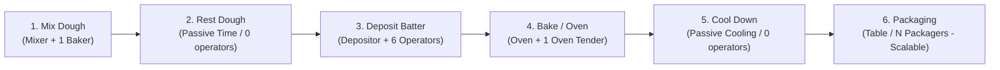
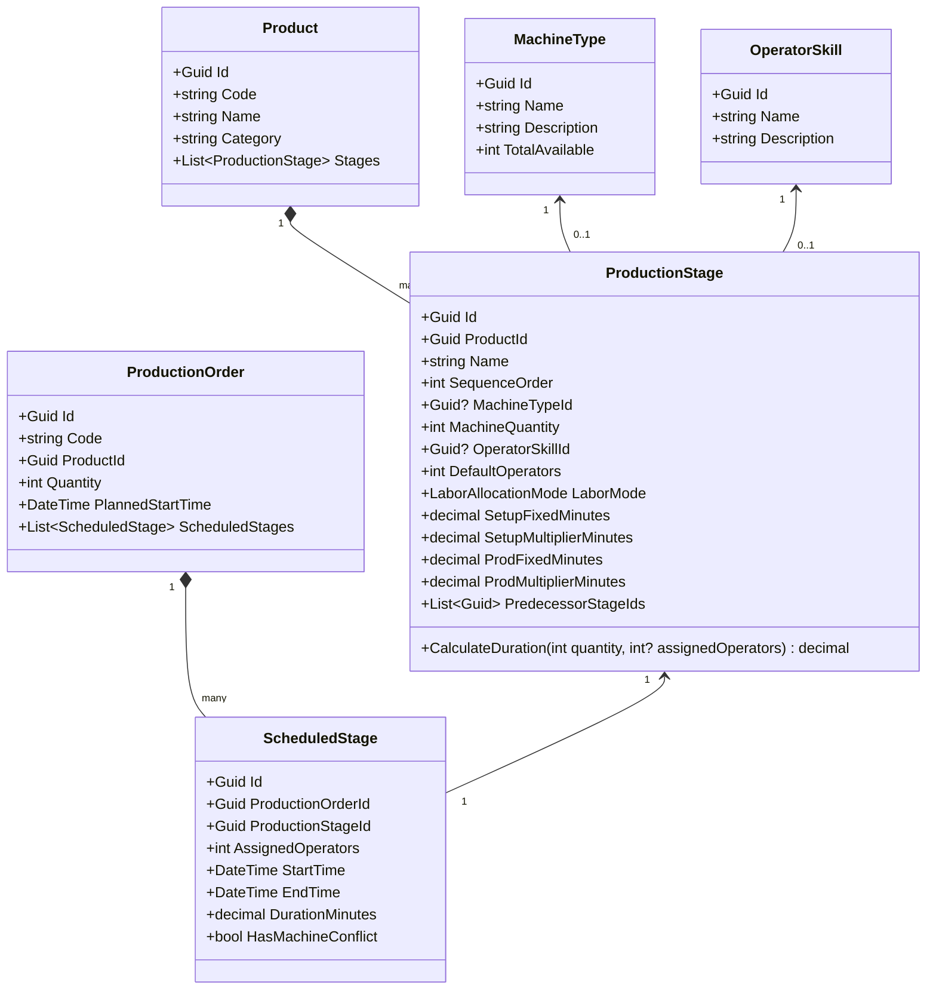

# Technical Specification (Tech Spec): Krono
## Production Planning & Control System (PPC / APS)

- **Official Product Name:** **Krono** (*Tagline: "Smart Production Planning & Scheduling | Just Krono it"*)
- **Version:** 1.0.0
- **Status:** Approved for Implementation
- **Target Market:** International / Canada (Bilingual EN/FR support, manufacturing-agnostic foundation)
- **Pilot Application Case:** Bakery & Industrial Confectionery (Cupcake Production Workflow)
- **Stack:** .NET 8 (C# Backend), Angular 18+ (Frontend), PostgreSQL 16 (Database), Docker

---

## 1. Product Overview and Objectives

### 1.1 Objective
Develop a modern web-based **Production Planning, Scheduling, and Resource Sizing** system tailored to the operational dynamics of **industrial bakeries and commercial confectionery plants** (batch production of cupcakes, breads, cakes, pastries, pies, and cookies).

The system allows production planners to schedule manufacturing orders via an interactive **Calendar/Agenda** interface, calculate process durations for each stage using mathematical formulas for setup and unit cycle times, size physical machinery and specialized labor (by skill/specialty), culminating in the generation of a **Consolidated Production Schedule Report** for both daily and weekly planning horizons.

### 1.2 Core Deliverables
1. **Manufacturing Master Data Management**:
   - Machine and equipment registries (planetary mixers, ovens, depositors, packaging tables, sealers).
   - Operator Skills and Roles registry (Mixer/Baker, Depositor Operator, Oven Tender, Packager, General Assistant).
   - Factory Operating Calendar (working shifts, scheduled breaks, and working days).
   - Product Catalog with multi-stage routing, predecessor dependencies (sequential and parallel branches), and resource allocation rules.
2. **Resource Sizing (No Capacity Gate / No Headcount Lock)**:
   - The scheduling engine **does not block or reject orders** based on an arbitrary operator headcount cap per shift.
   - The system calculates and displays with precision **how many workers of each specialty are required** to satisfy production demand $Q$ across any given time slot.
3. **Specialized Stage Mechanics**:
   - **Fixed Machine Crew**: Machinery that requires a mandatory crew size to operate safely and effectively (e.g., an automatic Cupcake Depositor requires a fixed crew of 6 concurrent operators).
   - **Labor-Scalable Productivity**: Stages whose execution duration contracts or expands depending on the number of workers assigned (e.g., manual cupcake packaging).
   - **Passive Wait / Resting Stages**: Non-labor stages that consume only clock time without human labor or powered machinery (e.g., dough fermentation/resting, ambient cooling after baking).
4. **Interactive Planning Calendar**:
   - Swift order entry ("New Order" action or direct click on date/time slot).
   - Automated stage decomposition and suggested timeline placements.
   - Manual fine-tuning through drag-and-drop interactions.
   - Dynamic operator headcount adjustment for scalable stages with real-time duration recalculation.
   - Visual machine fleet contention alerts (highlighting time slots where required machines exceed physical inventory).
5. **Consolidated Production Schedule Report (Core Focus)**:
   - Daily and Weekly timeline views.
   - Switchable perspectives: *By Machine/Workstation* vs. *By Order/Product*.
   - Labor sizing summary table: total man-hours and peak concurrency per specialty.
   - Print-optimized stylesheet (`@media print` for standard A4 landscape/portrait) and CSV/Excel data export.
6. **Central Screen Hub with Instant Local Filter**:
   - Fast navigation landing hub featuring an in-memory reactive search bar (instant filtering across titles and descriptions using Angular Signals).

---

## 2. Real-World Pilot Scenario: Cupcake Manufacturing Process

To validate and illustrate all business rules, the platform adopts a standard 6-stage **Cupcake Manufacturing Process**:



### Cupcake Stage Breakdown:
1. **Dough Mixing (Industrial Planetary Mixer)**:
   - *Machine Resource*: Industrial Planetary Mixer (1 unit).
   - *Labor Resource*: 1 Mixer / Baker.
   - *Behavior*: Base duration derived from fixed batch setup + batch cycle time.
2. **Dough Resting (Proofing / Structural Settling)**:
   - *Machine Resource*: None (ambient staging rack / resting bench).
   - *Labor Resource*: 0 operators (passive stage).
   - *Behavior*: Fixed clock duration for gluten and yeast stabilization (e.g., 30 minutes).
3. **Batter Depositing (Molding & Tray Dispensing)**:
   - *Machine Resource*: Automatic Tray Depositor / Dosing Unit (1 unit).
   - *Labor Resource*: **Fixed Crew of 6 Operators** (tray lining, batter hopper feed, visual quality checks, and conveyor outfeed).
   - *Behavior*: Machine is tightly coupled to the crew; it cannot run with fewer than 6 operators.
4. **Baking (Deck / Rotary / Tunnel Oven)**:
   - *Machine Resource*: Industrial Bakery Oven (1 unit).
   - *Labor Resource*: 1 Oven Tender.
   - *Behavior*: Cycle duration determined by thermal baking curve per batch.
5. **Cool Down (Ambient / Forced Convection Cooling)**:
   - *Machine Resource*: None (mobile cooling racks with perforated trays).
   - *Labor Resource*: 0 operators (passive stage).
   - *Behavior*: Mandatory thermal rest to prevent steam condensation and mold inside packaging (e.g., 45 minutes).
6. **Packaging (Boxing & Sealing)**:
   - *Machine Resource*: Packaging Table / Manual Heat Sealer (1 unit).
   - *Labor Resource*: **Labor-Scalable Productivity** (Skill: Packager).
   - *Behavior*: If 2 packagers are assigned, duration is 60 minutes; if 4 packagers are assigned, duration drops to 30 minutes.

---

## 3. Business Rules and Mathematical Formulations

### 3.1 Standard Unit of Measure
- **Minutes**: All setup times, cycle rates, rest periods, and computed schedule spans are tracked and stored in **minutes**.

### 3.2 Stage Typology & Labor Allocation Modes
Every routing stage defines a `LaborAllocationMode`:

1. **`Passive` (Waiting / Ambient Resting)**:
   - $Labor = 0$, $Machines = 0$.
   - Consumes only timeline clock hours.
   - $Duration = T_{fixed}$ minutes.
2. **`FixedTeam` (Fixed Crew / Rigid Coupling)**:
   - Requires exactly $K$ workers of a specific skill to operate the workstation (e.g., $K = 6$ operators on the Depositor).
   - Duration computed from setup and production unit parameters:
     $$Time_{Setup}(Q) = T_{setup\_fixed} + (T_{setup\_mult} \times Q)$$
     $$Time_{Production}(Q) = T_{prod\_fixed} + (T_{prod\_mult} \times Q)$$
     $$Duration_{Total}(Q) = Time_{Setup}(Q) + Time_{Production}(Q)$$
3. **`ScalableLabor` (Labor-Scalable Productivity)**:
   - The stage specifies a baseline recommended crew ($P_{default}$), but the planner may configure $P_{assigned} \ge 1$ during scheduling.
   - The production component scales inversely with assigned headcount:
     $$Time_{Setup}(Q) = T_{setup\_fixed} + (T_{setup\_mult} \times Q)$$
     $$Time_{Production}(Q, P_{assigned}) = \frac{T_{prod\_fixed} + (T_{prod\_mult} \times Q)}{P_{assigned}}$$
     $$Duration_{Total}(Q, P_{assigned}) = Time_{Setup}(Q) + Time_{Production}(Q, P_{assigned})$$

### 3.3 Topology and Dependencies (DAG - Directed Acyclic Graph)
- Each product defines an ordered set of stages $E = \{e_1, e_2, \dots, e_n\}$.
- Each stage references its direct predecessors $Pred(e_i)$.
- **Earliest Start Constraint**:
  $$Start(e_i) \ge \max_{p \in Pred(e_i)} \{ End(p) \}$$
- Stages without direct shared dependencies can run concurrently (parallel routes). Converging stages must wait until all upstream predecessor branches finish.

### 3.4 Factory Operating Shifts and Continuity
- The factory operates according to configurable weekly schedules (e.g., Monday through Friday, 07:00 to 17:00, with a lunch break from 12:00 to 13:00).
- In-progress active stages suspend execution at end-of-shift and resume at start-of-shift on the next business day.
- *Quality Warning*: The engine triggers an alert if a perishable resting stage or hot baking stage finishes outside operating hours to avoid products degrading inside ovens.

### 3.5 Labor Sizing Aggregation
Rather than bottlenecking the schedule with hard headcount locks, the engine aggregates concurrent demand at any instant $t$:
$$\text{Labor Demand}(t, \text{Skill}) = \sum_{e \in ActiveStages(t)} RequiredLabor(e, \text{Skill})$$
This metric feeds the sizing panel in both daily and weekly schedule reports.

### 3.6 Machine Fleet Contention (Visual Warning)
- When the concurrent demand for machine type $M$ exceeds physical availability at time $t$:
  $$\sum M_{type}(t) > M_{available\_type}$$
- The affected timeline blocks display a **prominent visual warning (red border + alert icon)** stating: *"Overload: 2 Mixers required, only 1 physically available during this period"*. The order remains on the schedule, giving the planner full visibility to adjust or resequence.

---

## 4. Final Production Schedule Report

### 4.1 Purpose and Audience
The report consolidates the operational schedule so that plant managers and shop floor supervisors know with clarity:
1. What items to produce across each hour of the day and week.
2. Which machines and workstations are occupied.
3. **Exactly how many workers per specialty are needed to execute the schedule**.

### 4.2 Report Sample Structure

```
========================================================================================
PRODUCTION SCHEDULE - WEEK 42 (10/06/2026 to 10/10/2026)
----------------------------------------------------------------------------------------
LABOR SIZING SUMMARY TABLE:
- Dough Mixer / Baker:      Peak: 3 workers | Total: 42 man-hours
- Depositor Operator:       Peak: 6 workers | Total: 24 man-hours
- Oven Tender:              Peak: 2 workers | Total: 38 man-hours
- Packager:                 Peak: 8 workers | Total: 80 man-hours
- General Assistant:        Peak: 2 workers | Total: 16 man-hours
----------------------------------------------------------------------------------------
DETAILED HOURLY SCHEDULE:
[08:00 - 09:30] PO-101 | Vanilla Cupcake (1,000 units) | Stage: Mix Dough     | Mixer 01       | 1 Baker
[09:30 - 10:00] PO-101 | Vanilla Cupcake (1,000 units) | Stage: Rest Dough    | [Passive: 0 workers]
[10:00 - 11:30] PO-101 | Vanilla Cupcake (1,000 units) | Stage: Deposit Dough | Depositor 01   | 6 Operators
[11:30 - 12:00] PO-101 | Vanilla Cupcake (1,000 units) | Stage: Bake          | Deck Oven 01   | 1 Oven Tender
[12:00 - 13:00] -- FACTORY LUNCH BREAK --
[13:00 - 13:45] PO-101 | Vanilla Cupcake (1,000 units) | Stage: Cool Down     | [Passive: 0 workers]
[13:45 - 15:15] PO-101 | Vanilla Cupcake (1,000 units) | Stage: Packaging     | Pack Table 01  | 4 Packagers (Scalable)
========================================================================================
```

### 4.3 Perspectives and Export Capabilities
- **By Machine / Workstation View**: Displays each equipment unit along a chronological timeline.
- **By Order / Product View**: Displays orders grouped with their stage chains.
- **Print Friendly (PDF / Paper A4)**: Dedicated `@media print` rules removing navigation sidebars and headers for clean executive printing.
- **Excel / CSV Export**: Structured tabular download for data analytics and ERP integration.

---

## 5. Software Architecture and SOLID Principles

### 5.1 Layered Architecture (.NET 8 Backend)
The backend follows Clean Architecture principles:

```
Krono.Backend/
├── src/
│   ├── Krono.Domain/
│   │   ├── Entities/               # Product, ProductionStage, MachineType, OperatorSkill, ProductionOrder, ScheduledStage
│   │   ├── Enums/                  # LaborAllocationMode (Passive, FixedTeam, ScalableLabor)
│   │   ├── ValueObjects/           # TimeRange, StageDurationFormula
│   │   └── Interfaces/             # Repositories and Domain Services
│   ├── Krono.Application/
│   │   ├── UseCases/               # CreateOrder, CalculateStageDuration, DetectConflicts, GenerateReport
│   │   ├── DTOs/                   # Request/Response contracts
│   │   └── Services/               # ProductionSchedulerService
│   ├── Krono.Infrastructure/
│   │   ├── Persistence/            # EF Core DbContext, PostgreSQL Npgsql
│   │   ├── Repositories/           # Data access implementations
│   │   └── Providers/              # WorkScheduleProvider
│   └── Krono.API/
│       ├── Controllers/            # ProductsController, SchedulesController, ReportsController, SkillsController
│       └── Program.cs              # DI, Swagger, Middlewares
```

### 5.2 Explicit SOLID Principles Mapping

| Principle | Concrete Implementation in Codebase |
| :--- | :--- |
| **S - Single Responsibility** | - `StageDurationCalculator`: Solely responsible for arithmetic computation of stage duration based on allocation mode.<br>- `ShiftCalendarEngine`: Strictly projects production minutes onto the factory work shifts.<br>- `MachineConflictDetector`: Exclusively evaluates machine fleet concurrency thresholds.<br>- `LaborDemandAggregator`: Totals required operator hours and peak headcounts per specialty. |
| **O - Open/Closed** | The `ILaborDurationStrategy` interface decouples duration calculation rules: `PassiveDurationStrategy`, `FixedTeamDurationStrategy`, and `ScalableLaborDurationStrategy`. New mechanics (e.g., volume-tier brackets) can be introduced by adding new classes without editing the core scheduling engine. |
| **L - Liskov Substitution** | All implementations of `ILaborDurationStrategy` fulfill the duration contract transparently without unexpected exceptions or violated domain invariants. |
| **I - Interface Segregation** | Fine-grained interfaces: `IReportQueryService` handles read-only queries for schedules and reports; `IScheduleCommandService` handles state mutations. |
| **D - Dependency Inversion** | Application use cases depend on domain abstractions (`IProductRepository`, `IScheduleRepository`, `IWorkShiftRepository`). Infrastructure implementations (EF Core, Npgsql) are injected via .NET's built-in IoC container. |

---

## 6. Domain Model and Entities

### 6.1 Domain Class Diagram



---

## 7. RESTful API Specification (.NET 8)

### 7.1 Endpoints

#### Operator Skills & Machine Types
- `GET /api/v1/operator-skills`: List operator skills and roles (Baker, Oven Tender, Packager, etc.).
- `POST /api/v1/operator-skills`: Register a new operator skill.
- `GET /api/v1/machine-types`: List machine types and physical fleet inventory count.
- `POST /api/v1/machine-types`: Register a machine type and available units.

#### Products & Stage Routings
- `GET /api/v1/products`: List registered products with stage summaries.
- `GET /api/v1/products/{id}`: Detailed product info including DAG stages and time formulas.
- `POST /api/v1/products`: Create a product and its routing stages (predecessors, labor modes, and time parameters).
- `PUT /api/v1/products/{id}`: Update an existing product and its routing definition.

#### Planning & Scheduling
- `POST /api/v1/schedules/simulate`: Simulate stage durations and labor demand for quantity $Q$ without persisting to database.
- `POST /api/v1/schedules/orders`: Create a Production Order and generate scheduled timeline blocks.
- `GET /api/v1/schedules/events?startDate=YYYY-MM-DD&endDate=YYYY-MM-DD`: Retrieve scheduled events within date range, including machine conflict flags and assigned labor.
- `PATCH /api/v1/schedules/events/{scheduledStageId}`: Update stage time slots (drag & drop) or alter assigned operators on scalable stages, recalculating completion time.
- `DELETE /api/v1/schedules/orders/{orderId}`: Delete an order and remove all associated schedule events.

#### Reports & Analytics
- `GET /api/v1/reports/production-schedule?viewType=day&date=YYYY-MM-DD`: Fetch daily production schedule and labor sizing panel.
- `GET /api/v1/reports/production-schedule?viewType=week&startDate=YYYY-MM-DD`: Fetch weekly schedule and total man-hours aggregated by specialty.
- `GET /api/v1/reports/production-schedule/export?format=csv&viewType=week&startDate=YYYY-MM-DD`: Download consolidated production schedule in CSV/Excel format.

---

## 8. Frontend & User Experience (Angular 18+)

### 8.1 Architecture & Best Practices
- **Angular 18+**: Sole use of **Standalone Components**, removing legacy NgModules.
- **Signals**: Reactive state management via `signal()`, `computed()`, and `effect()`, providing maximum rendering performance and granular change detection (Zoneless-ready).
- **Calendar Component**: Weekly and daily timeline view, with distinct color coding per product/stage and styling (e.g., neutral dashed borders) for passive resting stages.
- **Print Optimization**: Scoped `@media print` CSS hiding navigation sidebars and headers for pristine A4 export.

### 8.2 Central Screen Hub with Instant Local Filter
- Landing screen displaying module action cards.
- **In-Memory Browser Filtering**: Users can filter screens instantly by keyword across title and description without additional HTTP overhead:

```typescript
@Component({
  selector: 'app-screen-hub',
  standalone: true,
  imports: [CommonModule, FormsModule, RouterLink],
  template: `
    <div class="hub-container p-6">
      <div class="search-bar mb-6">
        <input 
          type="text" 
          placeholder="Search screen by name or description..."
          [ngModel]="searchTerm()"
          (ngModelChange)="searchTerm.set($event)"
          class="w-full p-3 border rounded-lg shadow-sm"
        />
      </div>

      <div class="grid grid-cols-1 md:grid-cols-2 lg:grid-cols-3 gap-6">
        @for (screen of filteredScreens(); track screen.route) {
          <div class="screen-card p-5 border rounded-xl hover:shadow-md transition">
            <h3 class="font-bold text-lg text-primary">{{ screen.name }}</h3>
            <p class="text-gray-600 text-sm mt-2">{{ screen.description }}</p>
            <a [routerLink]="screen.route" class="btn-navigate mt-4 inline-block text-blue-600 font-semibold">
              Open Screen →
            </a>
          </div>
        } @empty {
          <p class="text-gray-500">No screens match the search criteria.</p>
        }
      </div>
    </div>
  `
})
export class ScreenHubComponent {
  readonly searchTerm = signal('');
  
  readonly screens = signal<ScreenItem[]>([
    { name: 'Planning Calendar', description: 'Agenda view for production schedules, order generation, and stage adjustments.', route: '/planning' },
    { name: 'Schedule Report', description: 'Consolidated daily/weekly schedule, labor sizing breakdown, and export options.', route: '/reports' },
    { name: 'Products & Stage Routing', description: 'Configure recipes, duration formulas, and predecessor dependencies.', route: '/products' },
    { name: 'Machine Types', description: 'Manage factory physical fleet: mixers, ovens, depositors, and workstations.', route: '/machines' },
    { name: 'Operator Skills', description: 'Manage manufacturing roles: Mixer, Oven Tender, Packager, General Assistant.', route: '/skills' },
    { name: 'Factory Operating Shifts', description: 'Set up working shifts, scheduled breaks, and working days.', route: '/shifts' }
  ]);

  readonly filteredScreens = computed(() => {
    const query = this.searchTerm().toLowerCase().trim();
    if (!query) return this.screens();
    return this.screens().filter(s =>
      s.name.toLowerCase().includes(query) ||
      s.description.toLowerCase().includes(query)
    );
  });
}
```

---

## 9. Infrastructure and Containerization (Docker)

### 9.1 Container Services (`docker-compose.yml`)
Development and production environments run in 3 isolated containers:
1. `krono-db`: PostgreSQL 16 Alpine with persistent data volume.
2. `krono-backend`: .NET 8 ASP.NET Web API compiled with multi-stage build.
3. `krono-frontend`: Angular compiled client served via Nginx Alpine.

### 9.2 Docker Compose Configuration

```yaml
version: '3.8'

services:
  krono-db:
    image: postgres:16-alpine
    container_name: krono-db
    environment:
      POSTGRES_DB: krono_db
      POSTGRES_USER: krono_user
      POSTGRES_PASSWORD: krono_password
    ports:
      - "5432:5432"
    volumes:
      - pgdata:/var/lib/postgresql/data
    networks:
      - krono-network
    healthcheck:
      test: ["CMD-SHELL", "pg_isready -U krono_user -d krono_db"]
      interval: 5s
      timeout: 5s
      retries: 5

  krono-backend:
    build:
      context: ./backend
      dockerfile: Dockerfile
    container_name: krono-backend
    environment:
      - ConnectionStrings__DefaultConnection=Host=krono-db;Port=5432;Database=krono_db;Username=krono_user;Password=krono_password
      - ASPNETCORE_ENVIRONMENT=Development
      - ASPNETCORE_URLS=http://+:5000
    ports:
      - "5000:5000"
    depends_on:
      krono-db:
        condition: service_healthy
    networks:
      - krono-network

  krono-frontend:
    build:
      context: ./frontend
      dockerfile: Dockerfile
    container_name: krono-frontend
    ports:
      - "4200:80"
    depends_on:
      - krono-backend
    networks:
      - krono-network

networks:
  krono-network:
    driver: bridge

volumes:
  pgdata:
```

---

## 10. Phased Implementation Roadmap

1. **Phase 1: Foundation & Domain Layer**:
   - Initialize .NET 8 solution and Clean Architecture projects.
   - Domain entities with `LaborAllocationMode` rules (`Passive`, `FixedTeam`, `ScalableLabor`).
   - Unit tests validating stage duration formulas.
2. **Phase 2: Persistence & Work Shifts**:
   - EF Core mappings and PostgreSQL migrations.
   - Operating shift engine supporting working hours and weekend pauses.
3. **Phase 3: Sizing Engine & REST API**:
   - Aggregate labor demand per specialty and detect machine fleet concurrency conflicts.
   - API endpoints for products, orders scheduling, and reporting.
4. **Phase 4: Frontend - Master Data & Screen Hub**:
   - Set up Angular 18 with Standalone Components and Signals.
   - Central Screen Hub with instant in-memory search by name/description.
   - Forms and tables for Products, Stages, Skills, and Machines.
5. **Phase 5: Frontend - Interactive Calendar**:
   - Calendar view distinguishing active vs. passive stages.
   - Order creation dialog with real-time time simulation.
   - Drag & drop stage adjustments and dynamic operator scaling.
6. **Phase 6: Final Reporting & Data Export**:
   - Views by Machine and by Order.
   - Labor sizing summary panel (peak headcount and man-hours).
   - Print-ready A4 styling and CSV/Excel exporter.
